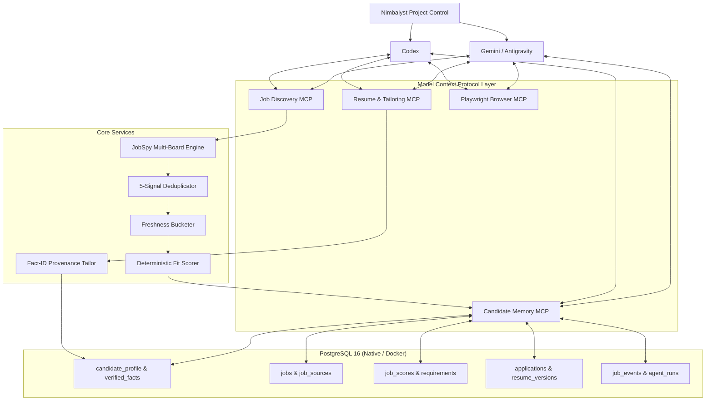

# System Architecture

The Job Search Operating System is a local-first, MCP-native guarded workflow managed through Nimbalyst. Codex and Gemini/Antigravity can operate the same deterministic services; PostgreSQL and verified artifacts remain authoritative.

## Architectural Tenets

1. **Agents Are Clients, Not Sources of Truth**: Codex and Gemini/Antigravity may reason, plan, and operate the workflow. Deterministic services validate their proposals, and PostgreSQL plus verified artifacts remain authoritative. Provider-specific adapters stay at the edges.
2. **Canonical Candidate Facts as the Single Source of Truth (SSOT)**: Every career claim, metric, and achievement is stored as an immutable verified fact with a unique `fact_id` (`fact_001`, `fact_002`, ...). The system forbids inventing facts. Unsupported JD requirements are flagged as gaps.
3. **5-Signal Deduplication**:
   - Signal 1: Normalized canonical URL (query parameters stripped, job keys extracted)
   - Signal 2: ATS direct apply URL (e.g. Lever, Greenhouse, Workday)
   - Signal 3: Source job ID (e.g. Indeed `jk`, LinkedIn ID)
   - Signal 4: Company + Normalized Title + Region hash
   - Signal 5: Normalized description content hash
4. **Multi-Window Freshness Model**:
   - `HOT` (0–24h): Top priority for twice-daily runs
   - `FRESH` (24–48h): Secondary freshness
   - `RECENT` (48–72h): Search inclusion window
   - `STALE` (>72h): Deprioritized / excluded from default alerts
5. **Configurable Fit Scoring**:
   - Role Alignment: 25%
   - Relevant Experience: 20%
   - Seniority Level: 15%
   - Required Skills: 15%
   - Domain / Product Relevance: 10%
   - Location / Remote Match: 5%
   - Compensation Fit: 5%
   - Company & Preference Fit: 5%
   - Recommendation bands: `exceptional` (90–100), `strong` (85–89), `review` (75–84), `weak` (65–74), `skip` (<65).
6. **Application Copilot & Guarded Automation Architecture**:
   - **Artifact & Readiness Gate**: Before any application action can begin, the system verifies that the job is in `READY` state, targets a secure HTTPS apply URL, and binds to the exact approved resume. Both the tailored text SHA256 digest and the on-disk compiled PDF SHA256 digest are re-computed and matched against database records. Symlinks and path traversal attempts are strictly forbidden.
   - **Form Snapshot & Immutability**: Antigravity extracts ATS form controls and records an immutable `form_snapshot` containing stable field keys, control types, labels, names, options, required flags, and a structural fingerprint.
   - **Deterministic Risk Governance**: Field inputs are classified into `SAFE`, `HUMAN_REVIEW`, and `PROHIBITED`. Any proposed field plan is deterministically validated by `FieldPlanValidator`:
     - Safe inputs must match verified candidate memory verbatim (no hallucinations).
     - Resume uploads must match the approved PDF artifact path and digest.
     - Ambiguous, legal, or demographic inputs cannot be filled automatically.
   - **Playwright MCP Action Boundary**: When the optional pinned Playwright MCP is configured and verified, Antigravity may use a headed browser to fill validated safe inputs and attach the approved PDF. Every reported action is audited in `application_fill_actions`.
   - **Checkpoint & Human Takeover**: Automation stops strictly at `WAITING_FOR_HUMAN`. An immutable `application_checkpoint` is created. The human user performs manual review, answers gated questions (authorization, disclosures), and executes the final submit button.
   - **Human-Only Outcome Recording**: `scripts/record_application_outcome.py` is invoked interactively by the user on a TTY to record confirmation of submission and update `applications` to `SUBMITTED_CONFIRMED`.
7. **Human-in-the-Loop Safety**:
   - Autonomous: Searching, collecting, normalizing, deduplicating, scoring, drafting documents, inspecting application forms, filling safe fields.
   - Strictly Gated: Work authorization, legal disclosures, demographic data, salary negotiation, and final application submission require explicit user review and confirmation.
