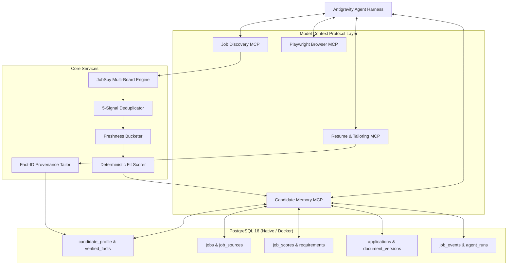

# System Architecture

The Job Search Operating System is a local-first, MCP-native autonomous workflow running under Antigravity as the primary agent/harness.

## Architectural Tenets

1. **Antigravity is the AI Brain**: No local Ollama, vLLM, or secondary LLM server is used. Antigravity performs all reasoning, decision-making, and user interaction.
2. **Canonical Candidate Facts as the Single Source of Truth (SSOT)**: Every career claim, metric, and achievement is stored as an immutable verified fact with a unique `fact_id` (`fact_001`, `fact_002`, ...). The system forbids inventing facts. Unsupported JD requirements are flagged as gaps.
3. **5-Signal Deduplication**:
   - Signal 1: Normalized canonical URL (query parameters stripped, job keys extracted)
   - Signal 2: ATS direct apply URL (e.g. Lever, Greenhouse, Workday)
   - Signal 3: Source job ID (e.g. Indeed `jk`, LinkedIn ID)
   - Signal 4: Company + Normalized Title + Region hash
   - Signal 5: Normalized description content hash
4. **Multi-Window Freshness Model**:
   - `HOT` (0–24h): Top priority for twice-daily runs
   - `FRESH` (24–48h): Secondary freshness
   - `RECENT` (48–72h): Search inclusion window
   - `STALE` (>72h): Deprioritized / excluded from default alerts
5. **Configurable Fit Scoring**:
   - Role Alignment: 25%
   - Relevant Experience: 20%
   - Seniority Level: 15%
   - Required Skills: 15%
   - Domain / Product Relevance: 10%
   - Location / Remote Match: 5%
   - Compensation Fit: 5%
   - Company & Preference Fit: 5%
   - Recommendation bands: `exceptional` (90–100), `strong` (85–89), `review` (75–84), `weak` (65–74), `skip` (<65).
6. **Human-in-the-Loop Safety**:
   - Autonomous: Searching, collecting, normalizing, deduplicating, scoring, drafting documents, inspecting application forms, filling safe fields.
   - Strictly Gated: Work authorization, legal disclosures, demographic data, salary negotiation, and final application submission require explicit user review and confirmation.
